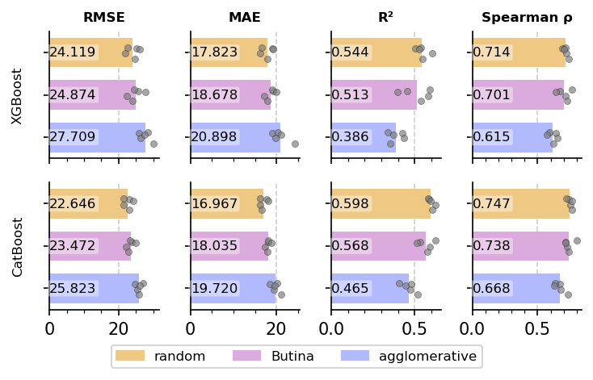

# Data accompanying Tox24 Challenge manuscript

The data for manuscript *Prediction of Compounds Activity against Transthyretin Using Machine Learning Algorithms and Low-Dimensional Molecular Descriptors: A Tox24 Challenge Study*

# Content

- `0-descriptors/` sets of descriptors used for training, testing, and evaluation (`train_train`, `train_test`, and `test500`, respectively)
- `1-feature-importance/`  - results of the features importance analysis
- `1-feature-importance/SHAP`  - .. SHAP analysis data
- `2-decomposition/`  - data used for decomposition and the results of PCA and tSNE
- `3-performance/` - performance of individual methods - 5 fold cv
- `3-performance-2Dvs3D/` - comparison of 2D, 3D and 2D+3D descriptors set - 5 fold cv
- `3-performance-cluster_basedCV/` - comparison of cv method (random split vs cluster based)

