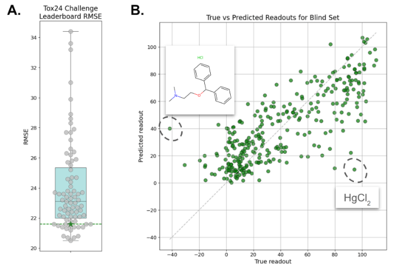

# Data accompanying Tox24 Challenge manuscript

The data for manuscript *Prediction of Compounds Activity against Transthyretin Using Machine Learning Algorithms and Low-Dimensional Molecular Descriptors: A Tox24 Challenge Study* describing approach used by the group **filipsPL** in [tox24 challenge](https://pubs.acs.org/doi/full/10.1021/acs.chemrestox.4c00192).

 (this repository)

# Content of this repository

- `0-descriptors/` sets of descriptors:
  - initial experiments - training, testing, and evaluation (`train_train`, `train_test`, and `test500`, respectively) (obsolete)
  - full set, used in cross-validation experiments (`ttr.csv.gz`)
- `1-feature-importance/`  - results of the features importance analysis
- `1-feature-importance/SHAP`  - .. SHAP analysis data
- `2-decomposition/`  - data used for decomposition and the results of PCA and tSNE
- `3-performance/` - performance of individual methods - 5 fold cv
- `3-performance-2Dvs3D/` - comparison of 2D, 3D and 2D+3D descriptors set - 5 fold cv
- `3-performance-cluster_basedCV/` - comparison of cv method (random split vs cluster based)

> [!NOTE]
> This research was funded in part by the National Science Centre, grant number: 2020/39/B/NZ2/03127 to FS.
